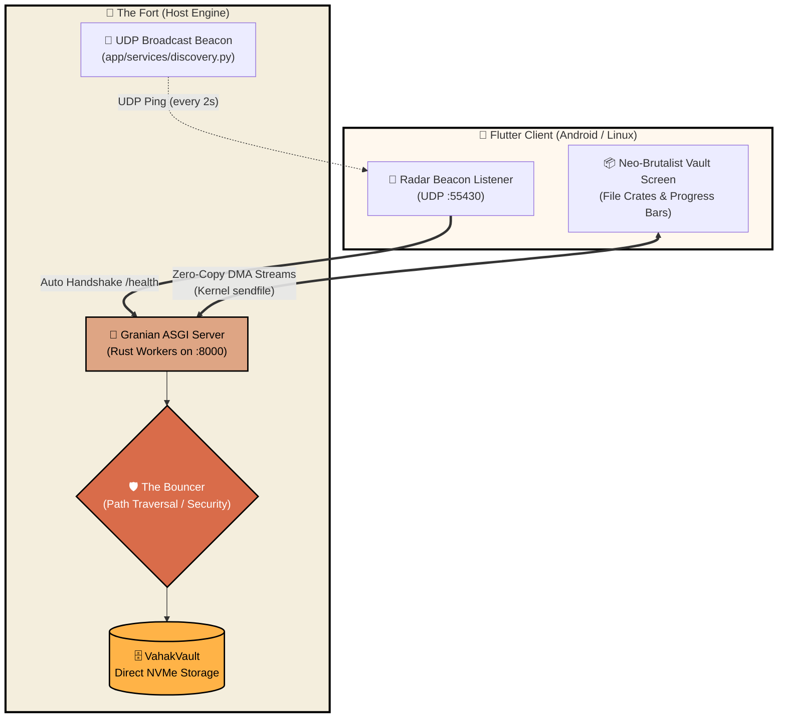

<div align="center">

# 🏰 VAHAK (वाहक)
### High-Throughput Peer-to-Peer Zero-Copy Local File Vault & Streaming Mesh

[](https://python.org)
[](https://fastapi.tiangolo.com)
[](https://github.com/emmett-framework/granian)
[](https://flutter.dev)
[-D96C4A?style=for-the-badge)](#the-zero-copy-pipeline)
[](#the-citadel-ui)

<br/>

> **"Vahak"** *(Sanskrit: वाहक — The Courier / Transporter)* is an ultra-fast, zero-cloud LAN synchronization engine and fortress-grade personal vault. Built with an asynchronous Python/Granian backend leveraging Linux `sendfile()` kernel primitives, coupled with an Indian Sandstone & Terracotta neo-brutalist Flutter client.

</div>

---

## ⚡ Why Vahak?

Most local file-sharing tools either rely on slow cloud relay servers, require complex pairing pins, or choke on multi-gigabyte 4K streams due to user-space buffer copying. 

**Vahak bypasses the bottleneck completely:**
- 📡 **Zero-Config Radar**: Autonomous UDP beacon discovery (`255.255.255.255:55430`) detects your local host ("The Fort") instantly without typing IP addresses.
- ⚡ **Zero-Copy DMA Streaming**: Uses Linux `sendfile()` and Granian's Rust-powered ASGI engine to pipe disk blocks directly to network sockets without touching user-space RAM.
- 🛡️ **The Bouncer (Hermetic Security)**: Enforces path-traversal isolation (`VAULT_DIR`), sanitizes filenames against cross-OS exploits, and rejects Windows-reserved stems (`CON`, `NUL`, `PRN`).
- 🎨 **Neo-Brutalist Citadel UI**: Built in Flutter with bold outlines, hard drop-shadows, and a warm palette inspired by Indian terracotta pottery and sandstone fortresses.

---

## 🧱 System Architecture



---

## 🎨 The Citadel UI Aesthetic

The user interface rejects generic sterile minimalism in favor of a tactile, high-contrast **Neo-Brutalist Sandstone** theme:

| Element | Color Code | Inspiration |
| :--- | :--- | :--- |
| **Sandstone Canvas** | `#F4EEDD` | Ancient desert fortress walls |
| **Terracotta Brick** | `#D96C4A` | Kiln-fired clay & brick battlements |
| **Torchlight Amber** | `#FFB347` | Guiding torchlight & active radar scans |
| **Pitch Black** | `#000000` | 4px hard neo-brutalist border strokes and drop shadows |

---

## 🛡️ The Bouncer: Hermetic Path Security

Every network path payload is treated as adversarial. The security core (`app/core/security.py`) enforces strict invariants:

- **Traversal Defense**: Neutralizes `../`, double URL-encoded traversals (`%2e%2e%2f`), and symlink escapes by resolving absolute canonical paths and asserting `path.is_relative_to(VAULT_DIR)`.
- **Filename Sanitizer**: Strips illegal control characters (`\x00-\x1f`), enforces ext4 255-byte limits, and rejects NTFS reserved device names (`CON`, `PRN`, `AUX`, `NUL`, `COM1-9`).
- **Bounded Ingestion**: 64 KB chunked streaming prevents memory exhaustion even when transferring multi-gigabyte raw video payloads.

---

## 📊 Low-Level Performance Prototypes

To find the theoretical maximum throughput for local streaming, we benchmarked multiple protocol implementations (available in [`test_scripts/`](test_scripts/)):

```
📁 test_scripts/
├── rust_server/       # Multi-threaded Actix-Web async filesystem scanner
├── server.go          # Go net/http high-concurrency baseline
├── stream.go          # Go binary chunk streamer
├── server.cpp         # C++ single-header httplib server
├── stream.cpp         # C++ raw POSIX sendfile implementation
└── zero_copy.py       # Python asyncio zero-copy sendfile proof-of-concept
```

---

## 🚀 Quickstart Guide

### 1. Boot "The Fort" (Python Backend)

```bash
# Clone the repository
git clone https://github.com/shreehari-2505/vahak.git
cd vahak

# Create and activate virtual environment
python3 -m venv .venv
source .venv/bin/activate

# Install dependencies
pip install -r requirements.txt

# Run test suite
pytest tests/

# Launch Granian engine (8 workers saturate NVMe & Gigabit LAN)
granian --interface asgi app.main:app --host 0.0.0.0 --port 8000 --workers 8
```

The Fort will immediately begin broadcasting its UDP discovery beacon on port `55430`.

### 2. Launch the Client (Flutter)

```bash
cd vahak_ui

# Fetch Dart dependencies
flutter pub get

# Run on Linux Desktop
flutter run -d linux

# Or deploy to connected Android device
flutter run -d android
```

The **Radar Scanner** will automatically pulse, discover the Hub IP on your WiFi/Ethernet network, and lock onto your Vault!

---

## 🗺️ Project Layout

```text
vahak/
├── app/                        # 🐍 Python / FastAPI Core Engine
│   ├── api/routes/             # Endpoints (scanner, sync, transfer)
│   ├── core/                   # Security Bouncer & Vault configuration
│   └── services/               # UDP Auto-Discovery & File System drivers
├── vahak_ui/                   # 📱 Neo-Brutalist Flutter Application
│   ├── lib/core/theme/         # Sandstone & Terracotta design tokens
│   ├── lib/features/discovery/ # Radar Screen & UDP Datagram listener
│   └── lib/features/vault/     # Vault browser, File Crates & progress bars
├── test_scripts/               # 🧪 C++, Go, and Rust low-level streaming benchmarks
├── tests/                      # 🛡️ Pytest security & traversal test suite
└── requirements.txt            # Python dependencies (Granian, FastAPI, orjson)
```

---

<div align="center">
  <sub>Forged with passion by <b>Shreehari Kadia</b> • Engineered for local-first autonomy</sub>
</div>

